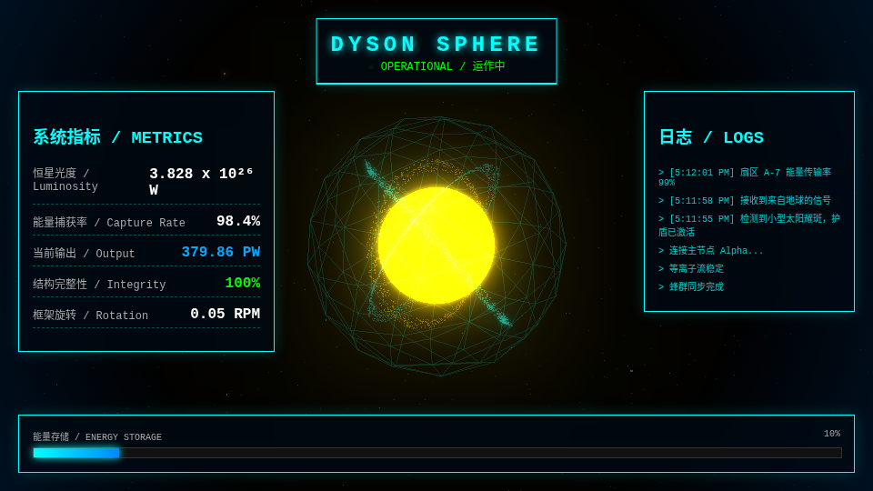

# Gai
这是我的个人作品仓库，欢迎享用～

GitHub：[https://github.com/GAI810/Gai](https://github.com/GAI810/Gai) · 邮箱：[zhiyigai2@gmail.com](mailto:zhiyigai2@gmail.com)（盖之怿）

## 戴森球运作监控

2025 年 11 月前后，Gemini 新模型刚出来，外面在聊它写前端行不行。我用**同一段提示词**，让同期几家模型各做一版「戴森球运作监控」；比下来，Gemini 那版的整体前端完成度，在当时算第一梯队。

页面是一个 HTML 文件：Three.js 里一颗会轻轻脉动的恒星、半透明线框球壳、三条颜色不同的粒子环，上面叠一层中英双语的赛博监控台。没有后端，也不用构建。下载 `dyson-sphere-dashboard.html` 后用浏览器打开即可；Three.js 从 CDN 加载，打开时需要联网。

- 打开演示：[`dyson-sphere-dashboard/index.html`](dyson-sphere-dashboard/index.html)（会跳到 [`dyson-sphere-dashboard.html`](dyson-sphere-dashboard/dyson-sphere-dashboard.html)）
- 动图：[`dyson-preview.gif`](dyson-sphere-dashboard/dyson-preview.gif)
- 产品卡片：[`product-dyson.html`](dyson-sphere-dashboard/product-dyson.html)
- 提示词：[`prompt-reconstructed.md`](dyson-sphere-dashboard/prompt-reconstructed.md)

这份提示词是**反推复原，不是历史原文**。当时的对话没找回来，文中内容是按成品页倒推的，只用来在作品集里说明当时在问什么。
